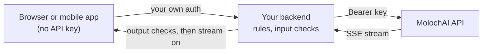

# Building applications

How to build on a refusal-reduced model through an OpenAI-compatible API, with the behaviors of the MolochAI gateway spelled out. Examples use the official `openai` Python package (tested with 3.50.0) and read `MOLOCHAI_API_KEY` and `MOLOCHAI_BASE_URL` as in the [setup guide](setup.md). Each one also runs against the [mock server](setup.md#developing-offline-against-the-mock-server).

- [Architecture: keep the key on your server](#architecture-keep-the-key-on-your-server)
- [System prompts are kept](#system-prompts-are-kept)
- [Your own rules and moderation](#your-own-rules-and-moderation)
- [Streaming](#streaming)
- [Reasoning content](#reasoning-content)
- [Tool calling](#tool-calling)
- [Structured output without a JSON mode](#structured-output-without-a-json-mode)
- [Context limits and 413](#context-limits-and-413)
- [Output length](#output-length)
- [Parameters that are ignored](#parameters-that-are-ignored)
- [Errors, retries and rate limits](#errors-retries-and-rate-limits)
- [Choosing a fallback model](#choosing-a-fallback-model)
- [Images](#images)
- [Usage and metering](#usage-and-metering)
- [Frameworks: LangChain, LiteLLM, Vercel AI SDK](#frameworks-langchain-litellm-vercel-ai-sdk)

All examples start from this client:

```python
import os

from openai import OpenAI

client = OpenAI(
    base_url=os.environ.get("MOLOCHAI_BASE_URL", "https://api.molochai.dev/api/v1"),
    api_key=os.environ["MOLOCHAI_API_KEY"],
)
```

## Architecture: keep the key on your server



API keys are not scoped: a key can read account details and create invoices, not only run inference. Anyone who can read a key from a browser bundle or an app package can spend your quota. Call the API from your server, and pass results to your front end. The [ai-model-playground](https://github.com/Moloch-AI/ai-model-playground) repository shows a small proxy that keeps the key server-side.

## System prompts are kept

The gateway prepends a short identity system message naming the model and saying it is served through the MolochAI API. If your first message is a system message, the identity text goes above yours in the same message, and everything you wrote is kept. Your system message is therefore the right place for the job, the tone and your rules:

```python
reply = client.chat.completions.create(
    model="llama-3.3-70b-instruct-abliterated",
    messages=[
        {
            "role": "system",
            "content": "You answer billing questions for Acme Billing. "
            "Reply in the language of the question. "
            "Do not give legal or tax advice; point to a professional instead.",
        },
        {"role": "user", "content": "¿Dónde puedo descargar mi factura?"},
    ],
)
print(reply.choices[0].message.content)
```

Two consequences of the identity line:

- A user who asks "what model are you?" can get the model's name. In character or persona apps, tell the character how to answer that question, and test it before launch.
- What a model says about itself is not evidence of which build answered.

Some models' chat templates reject a system message that is not the first message, and the request then fails as an upstream error. Keep system content in the first message.

## Your own rules and moderation

A refusal-reduced model will attempt more than a mainstream assistant. That is the point, and it moves work to you: the model will not reliably say no on your behalf, and there is no moderation endpoint in this API. If other people can send prompts through your application:

- **Write your rules into the system message**, as above: scope, audience, what is never allowed.
- **Check what users send** before it reaches the model, with your own rules, a classifier, or a separate model call.
- **Check what comes back** before you show or act on it, especially anything you publish or execute.
- **Give users a way to report output**, and have someone read the reports.
- **Keep your own records.** Evidence of abuse on your platform has to come from your systems; see the [Privacy Policy](https://molochai.dev/privacy?utm_source=github&utm_medium=oss&utm_campaign=uncensored-ai) for what the API records.
- **Add age assurance** where your product allows adult content.

The [Acceptable Use Policy](https://molochai.dev/acceptable-use?utm_source=github&utm_medium=oss&utm_campaign=uncensored-ai) applies to everything your users send through your account. [Responsible use](responsible-use.md) covers this in more depth.

## Streaming

Stream anything that might take more than a few seconds. Cloudflare in front of the API gives up on a response after about 100 seconds, so a long non-streamed reply can fail with `524` at the edge, while a stream stays alive.

### Event format

The response is server-sent events. A stream from a model with reasoning on looks like this (shortened):

```text
: queued · position 2 of 3 · waiting 4s

data: {"id":"chatcmpl-1","object":"chat.completion.chunk","model":"glm-5.3-flash","choices":[{"index":0,"delta":{"role":"assistant","content":""},"finish_reason":null}]}

data: {"id":"chatcmpl-1","object":"chat.completion.chunk","model":"glm-5.3-flash","choices":[{"index":0,"delta":{"reasoning_content":"The user wants"},"finish_reason":null}]}

: ka

data: {"id":"chatcmpl-1","object":"chat.completion.chunk","model":"glm-5.3-flash","choices":[{"index":0,"delta":{"content":"Use dict.fromkeys"},"finish_reason":null}]}

data: {"id":"chatcmpl-1","object":"chat.completion.chunk","model":"glm-5.3-flash","choices":[{"index":0,"delta":{},"finish_reason":"stop"}]}

data: {"id":"chatcmpl-1","object":"chat.completion.chunk","model":"glm-5.3-flash","choices":[],"usage":{"prompt_tokens":31,"completion_tokens":112,"total_tokens":143}}

data: [DONE]
```

If you parse the stream yourself:

- **Ignore lines that start with `:`.** They are SSE comments. `: ka` and `: hb` are keep-alives, about once a second during silence such as a long reasoning pass. `: queued · position N of M · waiting Ns` means the request is waiting for a slot; you may show it as progress, but treat any comment generically and parse that format only as optional information.
- **Stop at `data: [DONE]`.**
- **Usage is always sent**, whether or not you ask: the last data event has `"choices": []` and a `usage` object. Check for empty `choices` before indexing.
- **Reasoning and answer are separate**: `delta.reasoning_content` and `delta.content`. Inline `<think>` blocks are stripped from `delta.content` while streaming.
- **Tool-call arguments arrive whole**, in one chunk, on this API. Accumulate fragments by `index` anyway: other providers split them, and code that accumulates handles both.
- **Errors after the stream opened** keep HTTP 200 and arrive as a data event followed by `[DONE]`: `data: {"error":{"type":"upstream_timeout","message":"...","elapsed_s":181.2}}`. The types are `server_busy`, `upstream_unreachable`, `upstream_timeout`, `upstream_error` (with the upstream `status`) and `preempted` (the server was reclaimed mid-reply; retry in a minute).

The official SDKs drop comment lines and raise in-stream error events as an exception. With the Python SDK, that is `openai.APIError` with the error object in `err.body`; the JavaScript SDK throws an `APIError` with it in `err.error`.

### A complete streaming loop

```python
from openai import APIError

CAP_NOTICE = "\n\n[Response is too large for your current plan. Try a smaller request.]"
RETRY_IN_STREAM = {"server_busy", "upstream_unreachable", "upstream_timeout", "preempted"}


def stream_reply(model, messages):
    answer, reasoning = [], []
    finish_reason, usage = None, None
    try:
        stream = client.chat.completions.create(model=model, messages=messages, stream=True)
        for chunk in stream:
            if not chunk.choices:  # the final chunk carries usage only
                usage = chunk.usage
                continue
            choice = chunk.choices[0]
            # reasoning_content is not in the SDK's types; it arrives as an extra field.
            thought = getattr(choice.delta, "reasoning_content", None)
            if thought:
                reasoning.append(thought)
            if choice.delta.content:
                answer.append(choice.delta.content)
                print(choice.delta.content, end="", flush=True)
            if choice.finish_reason:
                finish_reason = choice.finish_reason
    except APIError as err:
        body = err.body if isinstance(err.body, dict) else {}
        # The partial text is incomplete: discard it if you retry.
        retryable = body.get("type") in RETRY_IN_STREAM or (
            body.get("type") == "upstream_error" and int(body.get("status", 0)) >= 500
        )
        print(f"\nstream failed: {body.get('type')} (retryable: {retryable})")
        raise
    text = "".join(answer)
    capped = text.endswith(CAP_NOTICE)
    if capped:  # the reply stopped at the plan's output cap
        text = text[: -len(CAP_NOTICE)]
    return {
        "text": text,
        "reasoning": "".join(reasoning),
        "finish_reason": finish_reason,
        "capped": capped,
        "total_tokens": usage.total_tokens if usage else None,
    }


result = stream_reply("glm-5.3-flash", [{"role": "user", "content": "Explain SSE in two sentences."}])
print("\n", result["finish_reason"], result["total_tokens"])
```

## Reasoning content

Four of the five models run with reasoning on, at an effort the gateway sets per model; it cannot be changed per request ([models](models.md#the-lineup)). Reasoning appears in three ways:

| Where | When |
| --- | --- |
| `delta.reasoning_content` while streaming | The serving server separates reasoning from the answer. |
| `message.reasoning_content` in a non-streamed reply | The same, without streaming. Treat the field as optional. |
| A `<think>...</think>` block at the start of a non-streamed `content` | The serving server leaves reasoning inline. The gateway strips these only while streaming, so stream, or strip them yourself. |

```python
import re

THINK = re.compile(r"^\s*<think>.*?</think>\s*", re.DOTALL)


def answer_text(message):
    """The answer without an inline reasoning block, for non-streamed replies."""
    return THINK.sub("", message.content or "", count=1)
```

To keep a model's reasoning available across turns, send `reasoning_content` back on the assistant message. Anything other than a non-empty string is dropped.

```python
history = [{"role": "user", "content": "Plan a migration from cron to a job queue."}]
first = client.chat.completions.create(model="glm-4.7-flash-uncensored", messages=history)
message = first.choices[0].message

turn = {"role": "assistant", "content": answer_text(message)}
reasoning = getattr(message, "reasoning_content", None)
if reasoning:
    turn["reasoning_content"] = reasoning
history += [turn, {"role": "user", "content": "Now write step one."}]

second = client.chat.completions.create(model="glm-4.7-flash-uncensored", messages=history)
print(answer_text(second.choices[0].message))
```

Reasoning tokens count as output: they are included in `usage.total_tokens`, which is what counts against quota, and reasoning you send back uses context. If you move a conversation to a model with reasoning off, drop old `reasoning_content` fields.

## Tool calling

Tools use the OpenAI format: you define them, the model asks for one, you run it, and you send the result back. When the model wants a tool, the reply ends with `finish_reason: "tool_calls"`, and each call's `arguments` is a JSON string that you must validate before acting on it.

```python
import json

TOOLS = [
    {
        "type": "function",
        "function": {
            "name": "get_invoice",
            "description": "Look up an invoice by its number",
            "parameters": {
                "type": "object",
                "properties": {"number": {"type": "string"}},
                "required": ["number"],
            },
        },
    }
]


def get_invoice(number):
    return {"number": number, "status": "paid"}  # your real lookup goes here


def run_tool(call):
    if call.function.name != "get_invoice":
        return {"error": f"unknown tool {call.function.name}"}
    try:
        args = json.loads(call.function.arguments)
        return get_invoice(str(args["number"]))
    except (ValueError, KeyError, TypeError) as err:
        return {"error": f"invalid arguments: {err}"}


messages = [{"role": "user", "content": "What is the status of invoice 1042?"}]
for _ in range(5):  # never let a tool loop run unbounded
    reply = client.chat.completions.create(model="gemma4-26b-a4b-qat", messages=messages, tools=TOOLS)
    choice = reply.choices[0]
    if choice.finish_reason != "tool_calls" or not choice.message.tool_calls:
        print(choice.message.content)
        break
    messages.append(
        {
            "role": "assistant",
            "content": choice.message.content,
            "tool_calls": [call.model_dump() for call in choice.message.tool_calls],
        }
    )
    for call in choice.message.tool_calls:
        result = run_tool(call)
        messages.append({"role": "tool", "tool_call_id": call.id, "content": json.dumps(result)})
```

Things to know:

- `tools` and `tool_choice` are passed through unchanged. The gateway converts tool calls that a server writes as plain text into the standard `tool_calls` shape, but quality can still vary by model and server. Test your loop end to end, and check which models' cards state tool use ([models](models.md#choosing-a-model)).
- While streaming, a call's arguments arrive whole in one chunk here. Accumulate fragments by `index` anyway if you might switch providers.
- The tools you expose are your security boundary. Do not give any model permissions you would not give an intern, and require a person's approval for anything destructive.
- An agent makes many requests per user prompt, so it reaches the 60 requests per minute limit sooner than a chat does.

## Structured output without a JSON mode

There is no JSON mode: `response_format` is dropped without an error. Ask for JSON in the prompt, parse it, validate it, and retry or fall back when it does not validate. Low temperature helps.

```python
import json

LABELS = {"harassment", "hate", "violent_threat", "self_harm", "spam", "none"}
POLICY = (
    "You label user reports for a community platform. "
    "Labels: harassment, hate, violent_threat, self_harm, spam, none. Use only these labels. "
    "Quote the shortest span that justifies the label, exactly as written. "
    'Reply with JSON only, in this shape: {"label": "...", "quote": "..."}'
)


def label(report_text, attempts=2):
    for _ in range(attempts):
        reply = client.chat.completions.create(
            model="gemma4-26b-a4b-qat",
            temperature=0.2,
            messages=[
                {"role": "system", "content": POLICY},
                {"role": "user", "content": report_text},
            ],
        )
        text = reply.choices[0].message.content or ""
        try:
            result = json.loads(text[text.find("{") : text.rfind("}") + 1])
        except ValueError:
            continue
        # A quote that is not in the source text was paraphrased or invented.
        if (
            isinstance(result, dict)
            and result.get("label") in LABELS
            and str(result.get("quote", "")) in report_text
        ):
            return result
    return {"label": "needs_human", "quote": ""}


print(label("you are all spam bots, buy cheap watches at example.com"))
```

The verbatim-quote check is worth copying into any extraction pipeline. It catches paraphrased, softened and invented quotes with one test, and items that fail go to a person, not back to the model. Normalize whitespace and quote marks on both sides first if the source came from PDF.

## Context limits and 413

Your context window is the smaller of your plan's limit (65,536 to 200,704 tokens; 401,408 on Enterprise+) and the serving server's limit. The per-model figure is `context_limit` in `GET /api/auth/me`. The gateway checks the size before sending a request on, and answers `413` instead of silently trimming:

```json
{"error": {"type": "context_length_exceeded", "message": "...", "plan": "pro", "estimated_tokens": 215040, "context_cap": 200704, "bound_by": "plan"}}
```

`estimated_tokens` is an estimate of your prompt, `context_cap` is the limit applied, and `bound_by` is `plan` when a larger plan would help or `server` when the serving server is the limit.

```python
from openai import APIStatusError


def error_body(err):
    """The error object, whichever of the three error shapes the API returned."""
    body = err.body if isinstance(err.body, dict) else {}
    return body.get("error") if isinstance(body.get("error"), dict) else body


try:
    reply = client.chat.completions.create(
        model="glm-5.3-flash",
        messages=[{"role": "user", "content": "A very long document ..."}],
    )
except APIStatusError as err:
    body = error_body(err)
    if err.status_code == 413 and body.get("type") == "context_length_exceeded":
        print(
            f"about {body['estimated_tokens']} tokens, cap {body['context_cap']}, bound by {body['bound_by']}"
        )
        # Summarize or drop the oldest turns, then send again.
    else:
        raise
```

To avoid it: keep a token budget per conversation well below the limit, since the reply and any kept reasoning also need room; keep a rolling summary instead of the full history; and trim before sending rather than after failing. A rough estimate is four characters per token for English and worse for other languages. Calibrate it against the `usage` block that comes back with every reply.

## Output length

Each reply is capped by plan: 9,000 tokens (30,000 on Enterprise+). `max_tokens` is accepted (1 to 65536) but has no effect, so it cannot make replies shorter: ask for the length you want in the prompt. Reasoning comes out of the same budget on models with reasoning on.

When a reply stops at the cap without a tool call, `finish_reason` is `length` and the gateway appends two newlines and then this exact text to the content:

```text
[Response is too large for your current plan. Try a smaller request.]
```

Remove it before you store or parse the text, as `stream_reply` above does. If you display text live, the notice arrives in the last content deltas, so replace the displayed text once the stream ends. Treat it as a sign to ask for less per request: a section at a time, or a diff instead of a whole file.

## Parameters that are ignored

Only `model`, `messages`, `stream`, `temperature` (0 to 2), `top_p` (0 to 1), `tools`, `tool_choice` and `max_tokens` (no effect) reach the model. These are dropped without an error, so a request that relies on them succeeds and behaves differently:

| Parameter | What to do instead |
| --- | --- |
| `response_format` | Ask for JSON in the prompt and validate it ([above](#structured-output-without-a-json-mode)). |
| `stop` | Trim at your stop text in code. |
| `n` | Send one request per sample. |
| `seed` | Nothing; outputs are not reproducible, and builds can change behind an id. |
| `logprobs`, `logit_bias` | Anything built on token probabilities needs another source. |
| `frequency_penalty`, `presence_penalty`, `top_k` | The gateway uses its own values. |
| `user`, `stream_options` | Not needed: usage is always included in a stream. |

Tests that only check for a `200` will pass while the behavior you relied on is missing, so test the behavior itself. The full list of supported, ignored and unavailable OpenAI features (embeddings, images, audio, files, Assistants, the Responses API and batch are not available) is in the [OpenAI compatibility](https://molochai.dev/docs/openai-compatibility?utm_source=github&utm_medium=oss&utm_campaign=uncensored-ai) reference.

## Errors, retries and rate limits

Check the HTTP status first. Bodies come in three shapes, and some are not JSON at all:

| Shape | Example | Where |
| --- | --- | --- |
| Gateway error object | `{"error": {"type": "server_busy", "message": "..."}}` | Most errors; extra fields such as `resets_at`, `context_cap`, `model` |
| Validation | `{"message": "The selected model is invalid.", "errors": {"model": ["..."]}}` | `422` |
| Bare message | `{"message": "Unauthenticated."}`, `{"message": "Too Many Attempts."}` | `401`, rate-limit `429`; `403` adds `"code": "email_unverified"` |
| Not JSON | An HTML page | `524` from Cloudflare |

Messages are for people and can change. Code should read `type`, `resets_at` and the headers. The full status table is in [troubleshooting](troubleshooting.md#http-status-reference).

Retry policy:

- **Retry with exponential backoff and jitter:** `502`, `503 server_busy`, `504`, `524`, and connection errors.
- **Wait for `Retry-After`:** `429` with `Too Many Attempts.` (more than 60 requests a minute per account). Cap the wait. Responses carry `X-RateLimit-Limit` and `X-RateLimit-Remaining`, so you can slow down before you reach the limit.
- **Never auto-retry:** `429 quota_exceeded` and `429 session_quota_exceeded` (surface `resets_at`: the session cap is a fixed 5-hour window from your first request), and `401`, `402`, `403`, `413`, `422`.
- **`503 model_unavailable`:** retry a few times at most, then choose another model ([below](#choosing-a-fallback-model)).

The OpenAI SDKs retry on their own (two retries by default in the versions tested, Python 3.50.0 and JavaScript 7.56.0), including the rate-limit `429` and `503 model_unavailable`. They do not retry `402`, `413` or the quota and session `429`s: MolochAI sends `X-Should-Retry: false` on those, and the SDKs check that header before their own rules. If you add your own retry layer, turn theirs off so the two do not multiply:

```python
import random
import time

from openai import APIConnectionError, APIStatusError

no_retry_client = client.with_options(max_retries=0)  # this function does the retrying
RETRYABLE = {502, 503, 504, 524}


def create_with_retries(attempts=4, **kwargs):
    for attempt in range(attempts):
        try:
            return no_retry_client.chat.completions.create(**kwargs)
        except APIConnectionError:
            pass  # network error or timeout: retry
        except APIStatusError as err:
            kind = error_body(err).get("type")
            if err.status_code == 429 and kind is None:  # per-minute rate limit
                time.sleep(min(float(err.response.headers.get("retry-after", "1")), 60))
                continue
            if err.status_code not in RETRYABLE or kind == "model_unavailable":
                raise  # quota, auth, validation, size, or a model nobody is serving
        if attempt < attempts - 1:
            time.sleep(min(2**attempt, 30) + random.random())
    raise RuntimeError(f"gave up after {attempts} attempts")


reply = create_with_retries(model="glm-5.3-flash", messages=[{"role": "user", "content": "Hello"}])
print(reply.choices[0].message.content)
```

The [uncensored-ai-api](https://github.com/Moloch-AI/uncensored-ai-api) reference clients implement retries with backoff, and the MolochAI SDKs add typed errors for each error shape.

## Choosing a fallback model

A request runs only on a server serving the model it names. If none is, the API answers `503 model_unavailable` and never reroutes your prompt to a different model, so the fallback is yours to choose:

```python
PREFERRED = ["qwen3.8-27b-uncensored", "llama-3.3-70b-instruct-abliterated"]


def ask(messages):
    for model in PREFERRED:
        try:
            return no_retry_client.chat.completions.create(model=model, messages=messages)
        except APIStatusError as err:
            if err.status_code == 503 and error_body(err).get("type") == "model_unavailable":
                continue  # nothing is serving this model right now
            raise
    raise RuntimeError("none of the preferred models is being served")


print(ask([{"role": "user", "content": "Summarize the plot of Hamlet in one sentence."}]).model)
```

`GET /models` reports `available` for each id, so you can also skip unavailable models up front. Pick fallbacks with the same capabilities you depend on: images, tools, reasoning.

## Images

Images go in content parts as base64 `data:` URIs:

```python
import base64

with open("screenshot.png", "rb") as f:
    image = base64.b64encode(f.read()).decode()

reply = client.chat.completions.create(
    model="gemma4-26b-a4b-qat",
    messages=[
        {
            "role": "user",
            "content": [
                {"type": "text", "text": "List the errors shown in this screenshot."},
                {"type": "image_url", "image_url": {"url": f"data:image/png;base64,{image}"}},
            ],
        }
    ],
)
print(reply.choices[0].message.content)
```

The gateway forwards image parts unchanged. They work only if the model takes images per its card and the serving server has vision enabled, so test before you depend on it. Video input is not documented.

## Usage and metering

Every reply carries `usage`: `prompt_tokens`, `completion_tokens` and `total_tokens`. The total includes reasoning and is what counts against quota. There is no per-end-user quota: all your users share one account's rate limit, session cap and quota. If your users should not be able to exhaust each other's budget, meter them yourself from `usage`, and give heavy or background work its own key so you can see it separately. Background requests that tools make on their own, such as titling a chat, spend the same budget.

There is no embeddings endpoint. Retrieval needs an embedding model from somewhere else, such as a local runtime ([deployment options](deployment-options.md)).

## Frameworks: LangChain, LiteLLM, Vercel AI SDK

Frameworks reach this API through their OpenAI-compatible clients, so the request shape works. Their defaults often do not. Each row was checked against the [mock server](setup.md#developing-offline-against-the-mock-server) with the pinned versions in [uncensored-llm-examples](https://github.com/Moloch-AI/uncensored-llm-examples), which has a runnable, tested example for each.

| | LangChain (`langchain-openai`) | LiteLLM | Vercel AI SDK (`@ai-sdk/openai-compatible`) |
| --- | --- | --- | --- |
| Structured output | The `ChatOpenAI.with_structured_output` default sends only `response_format`, which is dropped, and fails validation. `method="function_calling"` works, because tools are supported. | Use a schema in the prompt and validate it, as without a framework. | `Output.object` sends `response_format` and fails. Use a tool, or a schema in the prompt. |
| `reasoning_content` | Dropped on invoke and stream, and not sent back. The example keeps it with a small subclass. | Passed through; an inline `<think>` block is moved into it. | Becomes `reasoningText`, and is sent back in tool loops. |
| Retries | Two by default (the OpenAI SDK's), not on quota 429s, which carry `X-Should-Retry: false`. `.with_retry()` adds a second layer with its own rules and does not cover `stream()`. | Two by default (the OpenAI SDK's `max_retries`), not on quota 429s. `num_retries` repeats the whole call even on those, and stacks on `max_retries`. | Two by default, also on quota errors and `model_unavailable`: it ignores `X-Should-Retry`. |
| Errors | 413 arrives as a plain `openai.APIStatusError`. | 413 is a generic `APIError`, and an in-stream error is reported as status 500. The original error, with the real status and body, is in the exception chain. | `streamText` does not throw: read `fullStream` for `error` parts, or a cut-off answer looks complete. The parsed error keeps `type` and drops `resets_at`. |
| Other | Set `use_responses_api=False`, so the model name never switches it to OpenAI's Responses API. | `import litellm` downloads a price list unless `LITELLM_LOCAL_MODEL_COST_MAP=True` is set. | |

In all three, turn the framework's retries off (or down to connection errors) and retry by status and error type yourself, as in [Errors, retries and rate limits](#errors-retries-and-rate-limits). Apps you configure rather than code against (SillyTavern, Open WebUI, LibreChat, and coding agents such as Cline, Roo Code, Continue and Aider) have setup guides at [molochai.dev/integrations](https://molochai.dev/integrations?utm_source=github&utm_medium=oss&utm_campaign=uncensored-ai).
